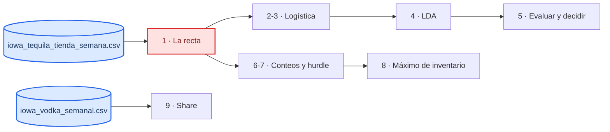

# Cuando y no es un número cualquiera · laboratorio

_Tiempo: 40 minutos en clase, el resto en casa · Nivel: intermedio (Python, pandas y la clase de regresión lineal)_

[](https://colab.research.google.com/github/nielspac177/glm-clasificacion-lab/blob/main/notebooks/LAB_GLM.ipynb)

¿Esta tienda va a pedir tequila la próxima semana? Y si pide, ¿cuántas botellas? En 82% de las semanas la respuesta es cero, y cuando hay pedido casi siempre es una caja de 12. Una regresión lineal predice botellas negativas para 6.5% de las semanas. Este lab trata de los modelos que respetan el tipo de y: logística y LDA para un sí o no, Poisson y binomial negativa para conteos, logit fraccional para participaciones de mercado.

Los datos son las ventas reales de licor del estado de Iowa: pedidos semanales de Jose Cuervo Especial Reposado (750 ml) en 400 tiendas, de marzo de 2012 a agosto de 2016. Es un problema de demanda intermitente, pariente del de refacciones. La última parte reutiliza el vodka del [lab de regresión lineal](https://github.com/nielspac177/regresion-lineal-lab).

## Qué vas a ver

En cada nivel escribes primero qué esperas y después corres la celda. Cuatro celdas tienen huecos `___` para completar.

| Nivel | Qué haces | Lo que se descubre |
| --- | --- | --- |
| 0 · Mirar | Ceros, media y varianza | 82% de ceros; la varianza es 26 veces la media |
| 1 · La recta | MCO para 0/1 y para botellas | Las probabilidades no se salen; 6.5% de botellas negativas |
| 2 · Logística | Razón de momios y efecto promedio | Momios × 1.56; en probabilidad, 6 puntos y no los 11 de la regla del 4 |
| 3 · scikit-learn | Penalización por defecto con 200 filas | Separación: −9.7 sin penalizar, −0.78 por defecto |
| 4 · LDA | Logística contra LDA con pocos datos | LDA gana con 30 filas; empatan desde 250 |
| 5 · Evaluar | Exactitud, AUC, PR, calibración y costos | "Nunca pide" tiene 83% de exactitud; el umbral 1/6 baja el costo 21% |
| 6 · Conteos | Poisson contra binomial negativa | Poisson predice 27% de ceros; hubo 83% |
| 7 · Hurdle | ¿Pide? por ¿cuánto? | El mejor MAE es pronosticar cero |
| 8 · Máximos | Cuantil 95% con tres supuestos | La binomial negativa cubre 94.9% |
| 9 · Share | MCO contra logit fraccional | MCO da shares negativos a los proveedores chicos |



## Cómo empezar

**En Google Colab:** usa el botón de arriba. La primera celda detecta Colab y descarga el repo.

**En tu computadora:**

```bash
git clone https://github.com/nielspac177/glm-clasificacion-lab.git
cd glm-clasificacion-lab
python3 -m venv .venv && source .venv/bin/activate
pip install -e .
jupyter notebook notebooks/LAB_GLM.ipynb
```

**En un notebook de Snowflake:** sube la carpeta del repo a tu workspace y agrega `statsmodels`, `scipy` y `scikit-learn` en **Packages**.

## Los datos

`data/iowa_tequila_tienda_semana.csv` tiene 78,417 filas: una por tienda y semana en que la tienda compró algo al estado. Las variables explicativas usan solo semanas anteriores.

| Columna | Qué es |
| --- | --- |
| `semana` | Lunes de la semana (AAAA-MM-DD) |
| `tienda`, `condado` | Número de tienda y condado |
| `pidio`, `botellas` | Si pidió el tequila esa semana y cuántas botellas |
| `tam_tienda` | Log de las botellas semanales de todos los productos en las 8 semanas activas anteriores |
| `pedidos_ult8`, `botellas_ult8` | Semanas con pedido y botellas del tequila en las 8 semanas activas anteriores |
| `semanas_desde_ultimo` | Semanas desde el último pedido del tequila (tope 52) |
| `mes`, `feriado` | Mes y semana de Acción de Gracias, Navidad o Año Nuevo |

`data/iowa_vodka_semanal.csv` es la tabla del lab de regresión lineal: 8 proveedores de vodka por semana, con su share de litros.

Las 400 tiendas son una muestra al azar (semilla fija) de las que compraron el producto y estuvieron activas al menos 120 semanas. El periodo termina en agosto de 2016 porque en septiembre la fuente cambia la forma de medir el volumen. Los scripts que arman las tablas están en el repositorio del curso, no en este.

## Cómo está organizado

```
glm-clasificacion-lab/
├── data/
├── notebooks/LAB_GLM.ipynb
├── src/glm_lab/
│   ├── datos.py           cargar_tequila, cargar_vodka, separar_por_fecha
│   ├── clasificacion.py   momios, logit, inv_logit, umbral_por_costos, costo_total
│   ├── calibracion.py     brier, tabla_calibracion
│   └── conteos.py         dispersion_pearson, prob_cero_poisson, prob_cero_nb, cuantil_nb
└── tests/test_glm_lab.py
```

Cada función tiene pruebas con valores calculados a mano. Para correrlas:

```bash
pip install -e ".[dev]"
pytest
```

## Para leer después

- James, Witten, Hastie y Tibshirani, _An Introduction to Statistical Learning_, capítulo 4: logística (4.3), LDA, QDA y naive Bayes (4.4) y GLM con Poisson (4.6)[^islr].
- Gelman, Hill y Vehtari, _Regression and Other Stories_, capítulos 13 a 15, para leer coeficientes logísticos y de conteo sin fórmulas[^ros].
- Ng y Jordan (2001) sobre por qué un modelo generativo como LDA gana con pocos datos[^ng].
- Saito y Rehmsmeier (2015) sobre la curva de precisión-recall con clases raras[^saito].
- Kolassa (2016) sobre cómo evaluar pronósticos de conteos con muchos ceros[^kolassa].

## Licencia de los datos

Iowa Liquor Sales lo publica el Departamento de Comercio de Iowa como datos abiertos; aquí se usa el espejo de Kaggle `residentmario/iowa-liquor-sales`, con licencia CC0 1.0 (dominio público)[^iowa].

[^islr]: James, G., Witten, D., Hastie, T. y Tibshirani, R. (2021). _An Introduction to Statistical Learning_, 2.ª ed. Springer. https://www.statlearning.com
[^ros]: Gelman, A., Hill, J. y Vehtari, A. (2020). _Regression and Other Stories_. Cambridge University Press. https://avehtari.github.io/ROS-Examples/
[^ng]: Ng, A. y Jordan, M. (2001). On discriminative vs. generative classifiers: a comparison of logistic regression and naive Bayes. _NIPS 14_. https://papers.nips.cc/paper_files/paper/2001/hash/7b7a53e239400a13bd6be6c91c4f6c4e-Abstract.html
[^saito]: Saito, T. y Rehmsmeier, M. (2015). The precision-recall plot is more informative than the ROC plot when evaluating binary classifiers on imbalanced datasets. _PLOS ONE_, 10(3). https://doi.org/10.1371/journal.pone.0118432
[^kolassa]: Kolassa, S. (2016). Evaluating predictive count data distributions in retail sales forecasting. _International Journal of Forecasting_, 32(3), 788-803. https://doi.org/10.1016/j.ijforecast.2015.12.004
[^iowa]: Iowa Department of Commerce, Alcoholic Beverages Division. Iowa Liquor Sales. Espejo usado: https://www.kaggle.com/datasets/residentmario/iowa-liquor-sales
